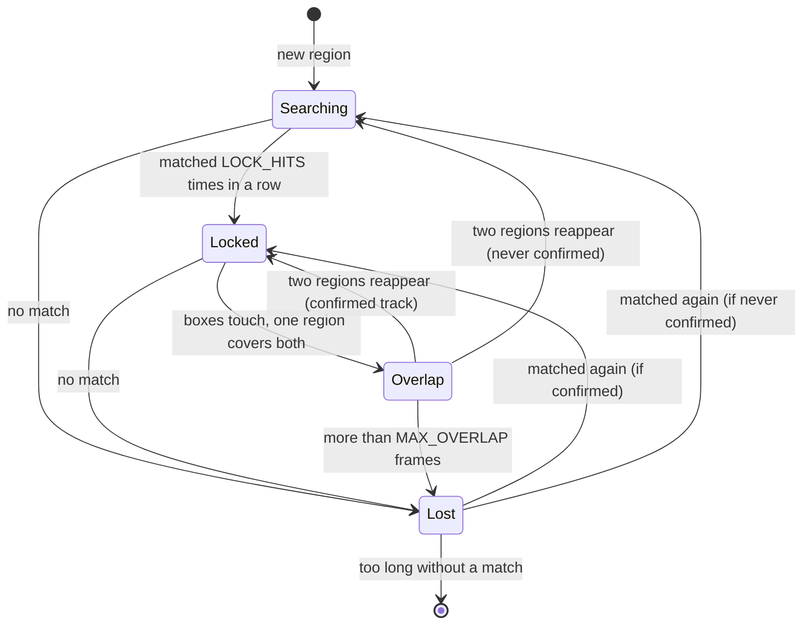

# Architecture

This document explains how Rustvision works, from the camera frame to the drawn box. It describes the code as it is, not the full target architecture.

## Overview

```
camera ──► RGB buffer ──► grayscale buffer ──► change mask ──► regions ──► tracker ──► display buffer ──► window
  (nokhwa)     (reused)         (reused)           (reused)     (blobs)     (tracks)      (0RGB, reused)    (minifb)
```

Everything that is allocated lives outside the main loop. Each frame reuses the same buffers, so the loop itself does not allocate.

## Modules

| File | Role |
|---|---|
| `src/main.rs` | Opens the camera and the window, runs the loop, handles keyboard input and camera errors |
| `src/pipeline/blobs.rs` | Connected components: turns the change mask into regions (box, area, centre) |
| `src/pipeline/tracker.rs` | Tracks: prediction, matching, state machine, overlaps |
| `src/pipeline/display.rs` | Draws boxes, crosses and identifiers into the display buffer |

## One frame, step by step

1. **Capture.** The camera fills `rgb_buffer` (3 bytes per pixel). A failed capture is either skipped or, after one second without a valid frame, ends the program.
2. **Grayscale and colour.** One pass over `rgb_buffer` writes the grayscale value into `gray_buffer` (weighted average, for detection) and the colour value into the display buffer (0RGB, for the window).
3. **Background.** The first frame becomes the reference background. `Space` replaces it with the current frame.
4. **Change mask.** A pixel is "changed" when its grayscale difference from the background is at least the threshold. The result is a `Vec<bool>`, not an image.
5. **Regions.** `find_regions` walks the mask with a flood fill, using a queue. Each connected group becomes a `Region` (bounding box, area, centre). Groups smaller than the minimum area are discarded. The mask is consumed: every pixel is cleared, so the next frame starts clean.
6. **Tracking.** `Tracker::update` associates regions with tracks, updates their states, and creates new tracks for unmatched regions (see below).
7. **Drawing.** `draw_tracks` draws each track on top of the colour image. The window then shows the buffer.

Detection works on the grayscale mask. The window shows the colour image. The two are separate buffers, so changing the display does not change the detection.

## Tracking

### Track data

Each `Track` stores:

- its identifier (`id`, never reused),
- its state (`TrackState`),
- its smoothed position (`x`, `y`) and velocity (`vx`, `vy`),
- its box half-size (`half_w`, `half_h`),
- a small circular buffer of its last areas, used to measure growth,
- whether it has ever been confirmed.

### States



| State | Meaning | Colour |
|---|---|---|
| `Searching` | New track, not confirmed yet | yellow |
| `Locked` | Confirmed, matched on each frame | green |
| `Lost` | No match: the track keeps moving on its velocity, with damping | red |
| `Overlap` | Two tracks share one region: they ignore it and keep their size | orange |

`match` on `TrackState` has no catch-all branch, so adding a state forces the compiler to show every place that must handle it.

### Matching

For each track, the tracker predicts a position (`position + velocity`). It then computes a cost for every region within `MAX_DIST` of that prediction:

- the distance to the prediction, divided by the track's size, so that it is unitless;
- plus a size term: the relative difference between the region's size and the track's average size, weighted by `SIZE_WEIGHT`.

Pairs are sorted by cost and accepted greedily: a pair is taken only if neither the track nor the region is already used. This makes the result independent of the order of detections.

Right after an overlap ends, the size weight is raised to `SIZE_WEIGHT_AFTER_OVERLAP` for that one frame. Position alone cannot tell a bounce from a crossing, but size can.

### Overlaps

- **Entry.** Two `Locked` tracks whose predicted boxes touch, and whose nearest region is the same, enter `Overlap`.
- **During an overlap.** The tracks ignore the shared region, move at constant velocity, and freeze their area history, so the merged region does not corrupt it. The region is marked as taken, so no new track is created from it.
- **Exit by separation.** Two distinct regions reappear, each close to one track. The tracks resume normal tracking.
- **Exit by timeout.** After `MAX_OVERLAP` frames without separation, the tracks fall back to the normal path: one can take the region, the other is lost.

### Deletion and identifiers

- A `Lost` track is deleted after `MAX_LOST` frames if it was confirmed, or `MAX_LOST_TENTATIVE` frames if it was not.
- A new track gets the next identifier from a counter that only increases, so a deleted identifier is never given to another object.

## Camera errors

- A failed frame is skipped, and the loop waits 30 ms before retrying, to avoid spinning.
- The timestamp of the last valid frame is updated on each success. If more than `CAMERA_TIMEOUT` (1 second) passes without a valid frame, the program ends with an error message.
- The decision is a pure function (`on_capture_error`) that only depends on the elapsed time, so it is tested without a camera.

## Constants

| Name | Value | Where | Role |
|---|---|---|---|
| `MAX_DIST` | 50 px | `tracker.rs` | Largest distance between a prediction and a region |
| `LOCK_HITS` | 3 | `tracker.rs` | Matches needed to become `Locked` |
| `MAX_LOST` | 30 frames | `tracker.rs` | Lifetime of a lost confirmed track |
| `MAX_LOST_TENTATIVE` | 5 frames | `tracker.rs` | Lifetime of a lost unconfirmed track |
| `ALPHA` | 0.5 | `tracker.rs` | Position smoothing: weight of the measurement |
| `BETA` | 0.3 | `tracker.rs` | Velocity smoothing: weight of the new displacement |
| `DAMPING` | 0.9 | `tracker.rs` | Velocity decay while lost |
| `AREA_HISTORY` | 4 | `tracker.rs` | Number of areas remembered per track |
| `MAX_OVERLAP` | 5 frames | `tracker.rs` | Longest allowed overlap |
| `SIZE_WEIGHT` | 0.5 | `tracker.rs` | Weight of size in matching |
| `SIZE_WEIGHT_AFTER_OVERLAP` | 4.0 | `tracker.rs` | Weight of size right after a separation |
| `CAMERA_TIMEOUT` | 1 s | `main.rs` | Time without a valid frame before exiting |

The tracker works in frames, not seconds: at 15 fps, `MAX_LOST` = 30 frames lasts about 2 seconds.

## Known limits

See the README, section "Known limitations".
